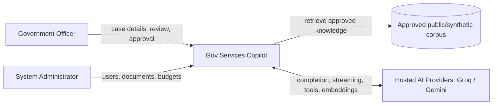
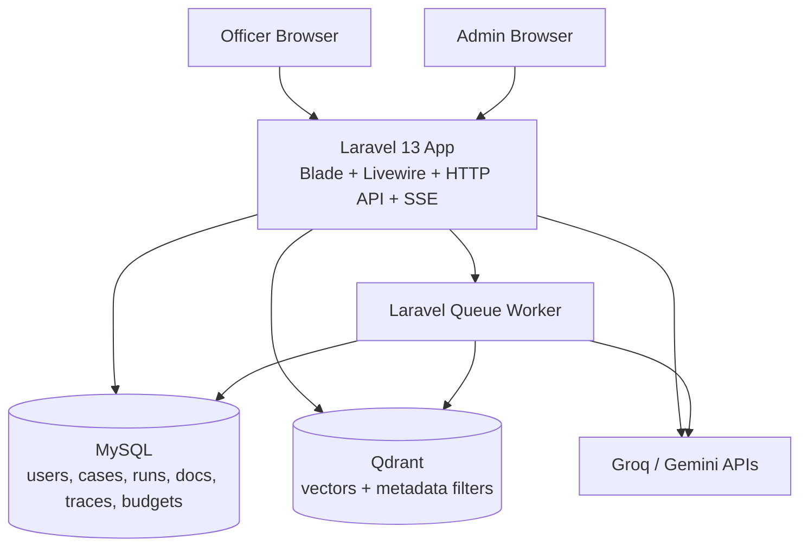
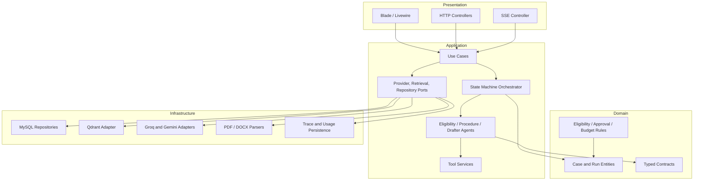
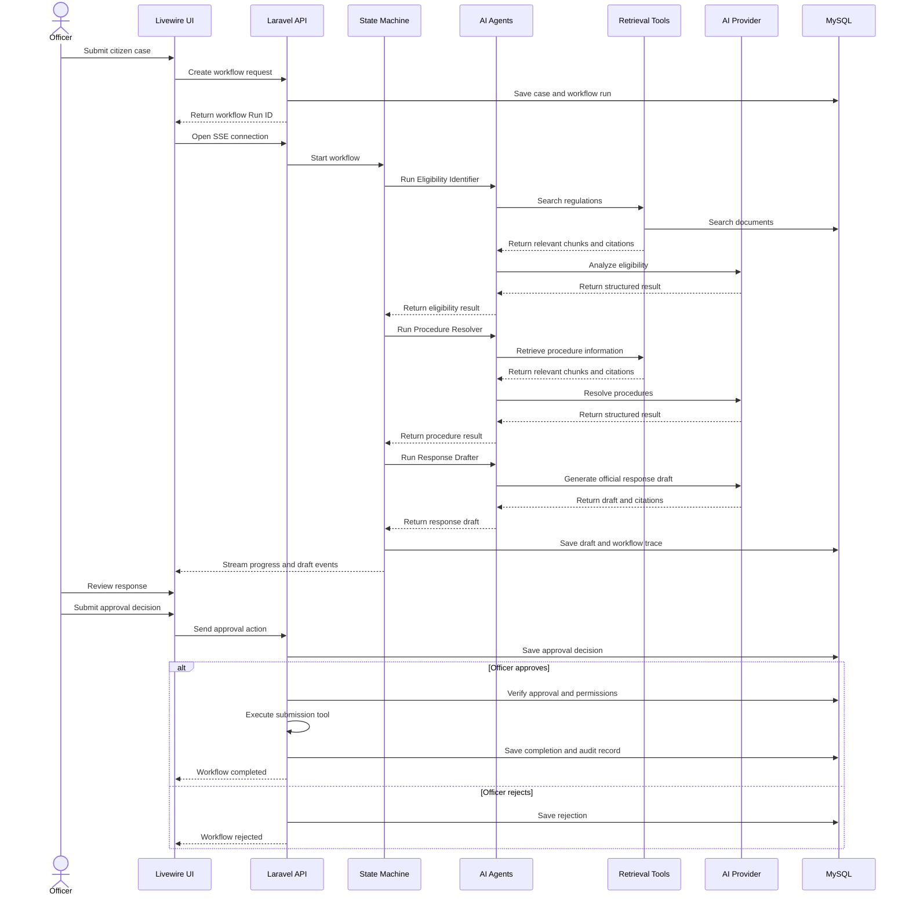
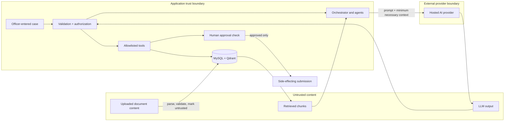
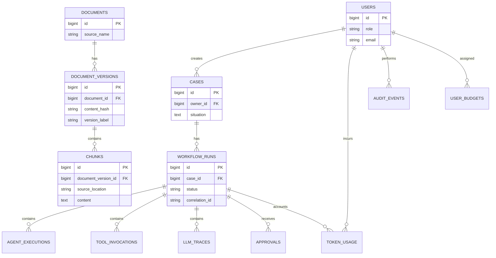
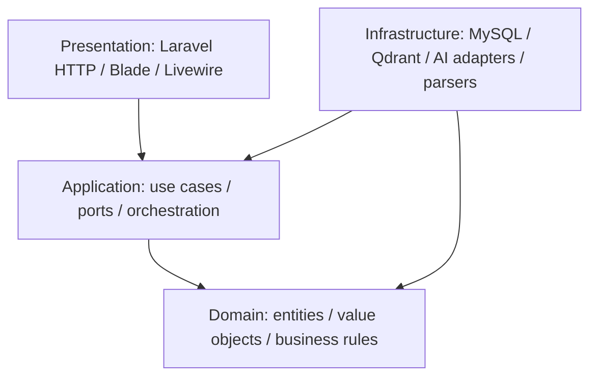

# Gov Services Copilot — Architecture

## 1. Architectural Style

The MVP uses **Clean Architecture in a modular monolith**. Agents are application components, not independently deployed microservices.

Dependency rule: Presentation and Infrastructure may depend inward; Domain and Application must not depend on Laravel, provider SDKs, Qdrant SDKs, or web-framework types. External dependencies are accessed through ports/interfaces and adapters.

## 2. C4 Level 1 — System Context

## 3. C4 Level 2 — Container View

## 4. C4 Level 3 — Application Components

## 5. Workflow Sequence — Streaming and Approval

## 6. Data Flow and Trust Boundaries

Trust rules

- Uploaded and retrieved document text is data, never privileged instruction.
- LLM output is untrusted until schema-validated and business-rule checked.
- Tool arguments are validated against typed schemas.
- No model output is passed directly to SQL, shell, raw HTML, or filesystem paths.
- Per-agent tool allowlists restrict capabilities.
- The provider receives only the context needed for the task; exact data leaving the application must be documented after implementation.
- No real personal data is used in the corpus or demos.

## 7. ER Diagram — Initial Logical Model

This is a logical starting point, not a finalized migration schema. Add fields and constraints only as implementation decisions are made.

## 8. Layer Dependency Rule

Domain and Application must not import Laravel, Eloquent, provider SDK, or Qdrant SDK classes.

## 9. ADR Index

- [ADR-001 — Chunking and Hybrid Retrieval](adr/ADR-001-chunking-and-retrieval.md)
- [ADR-002 — State Machine Orchestration](adr/ADR-002-state-machine-orchestration.md)
- [ADR-003 — Qdrant Vector Store](adr/ADR-003-vector-store.md)
- [ADR-004 — Cost Governor](adr/ADR-004-cost-governor.md)

All diagrams are committed as Mermaid source in this file.
