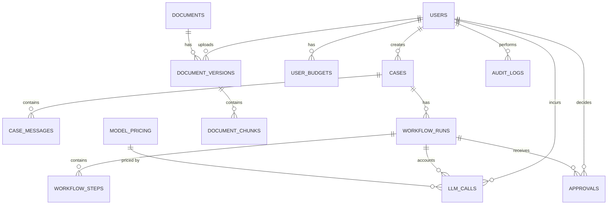

# Gov Services Copilot — Database Design

**Status:** Approved for implementation  
**Stack:** PHP 8.3, Laravel 13, MySQL 8, Qdrant  
**Tables:** 13  
**Date:** 2026-11-22

---

## 1. Purpose and Scope

MySQL is the source of truth for all application data. Qdrant is a derived vector index (not transactionally coupled). Supports all mandatory requirements from ITI-task.md (FR-01–FR-09, T3 Cost Governor, BR-01–BR-12).

**Out of scope:** citizen accounts, multi-tenancy, microservices, separate search platform, OCR, generated DOCX/PDF output, advanced analytics, notifications.

---

## 2. Table Inventory (13 Tables)

| #   | Table               | Responsibility                                                             |
| --- | ------------------- | -------------------------------------------------------------------------- |
| 1   | `users`             | Authentication (Fortify) + role (officer/admin)                            |
| 2   | `user_budgets`      | Per-user budget limit, period, consumed/reserved tokens                    |
| 3   | `model_pricing`     | Provider/model token pricing (seeder-populated)                            |
| 4   | `cases`             | Case identity, owner, citizen's situation, status                          |
| 5   | `case_messages`     | Conversation history with citation JSON                                    |
| 6   | `documents`         | Logical document identity (filename only)                                  |
| 7   | `document_versions` | Each uploaded version: file_path, content_hash, status, uploader           |
| 8   | `document_chunks`   | Chunk text + metadata; `id` = Qdrant point ID                              |
| 9   | `workflow_runs`     | Run ID, correlation ID, state, draft/final text, estimated/reserved tokens |
| 10  | `workflow_steps`    | Step execution: agent/tool, status, retries, timing, errors                |
| 11  | `llm_calls`         | Trace store: tokens, cost, price snapshot, currency, status, error         |
| 12  | `approvals`         | Audited approval: approve/reject/edit-and-approve                          |
| 13  | `audit_logs`        | Security/audit events                                                      |

No `citizens`, `roles`, `agent_configs`, or `reservations` tables.

---

## 3. Key Schema Details

### 3.1 `users`

`id PK`, `name`, `email UNIQUE`, `password`, `role ENUM('officer','admin')`, `email_verified_at`, `remember_token`, timestamps

### 3.2 `user_budgets` (single source of truth for budget)

`id PK`, `user_id FK→users`, `period_start`, `period_end`, `budget_limit`, `consumed_tokens DEFAULT 0`, `reserved_tokens DEFAULT 0`, timestamps  
**Unique:** `(user_id, period_start)` — one budget record per user and period start date. Budget period is calendar month. Initial `user_budgets` row is created by an admin together with the `User` in a single transaction, using `DEFAULT_USER_TOKEN_BUDGET` from `.env` as the default limit. Overlapping periods with different start dates are handled at the Application Layer.

### 3.3 `model_pricing`

`id PK`, `provider`, `model`, `input_price_per_1k`, `output_price_per_1k`, `currency DEFAULT 'USD'`, `effective_from`, `effective_to NULL`, `created_at`  
**Unique:** `(provider, model, effective_from)`. App layer selects effective price per call date; validates no overlapping active rates.

### 3.4 `cases`

`id PK`, `user_id FK→users` (officer who created it), `title`, `situation` (citizen's situation), `status DEFAULT 'open'`, timestamps

### 3.5 `case_messages`

`id PK`, `case_id FK→cases`, `sender_type ENUM('officer','ai_assistant')`, `content`, `citations JSON NULL`, `created_at`

### 3.6 `documents` — logical identity only

`id PK`, `filename`, timestamps  
No processing status, file path, or upload actor here (those live on `document_versions`).

### 3.7 `document_versions`

`id PK`, `document_id FK→documents`, `version_label`, `content_hash UNIQUE` (BR-08 duplicate detection), `file_path`, `uploaded_by FK→users` (admin only), `status ENUM('pending','processing','indexed','failed') DEFAULT 'pending'`, `failure_details NULL`, `chunk_count DEFAULT 0`, `indexed_at NULL`, `created_at`  
**Unique:** `(document_id, version_label)`  
Lifecycle: `pending → processing → indexed` or `pending → processing → failed`. `indexed` = extraction, chunking, embedding, Qdrant indexing complete.

### 3.8 `document_chunks`

`id PK` (Qdrant point ID), `document_version_id FK→document_versions`, `chunk_index`, `content`, `page_number NULL`, `section NULL`, `clause NULL`, `created_at`  
**Unique:** `(document_version_id, chunk_index)`

### 3.9 `workflow_runs`

`id PK`, `case_id FK→cases`, `run_uuid UNIQUE`, `correlation_id`, `run_type ENUM('officer','evaluation') DEFAULT 'officer' NOT NULL`, `current_state ENUM(RECEIVED, ELIGIBILITY_CHECK, PROCEDURE_RESOLUTION, RESPONSE_DRAFTING, NEEDS_INFORMATION, PENDING_APPROVAL, APPROVED, REJECTED, COMPLETED, FAILED, CANCELLED) DEFAULT 'RECEIVED'`, `draft_response NULL`, `final_response NULL`, `estimated_tokens DEFAULT 0`, `reserved_tokens DEFAULT 0`, `cancellation_requested_at TIMESTAMP NULL`, `started_at NULL`, `completed_at NULL`, timestamps  
No separate `status` column — `current_state` is authoritative.

### 3.10 `workflow_steps`

`id PK`, `workflow_run_id FK→workflow_runs`, `step_type ENUM('agent','tool')`, `name`, `input JSON NULL`, `output JSON NULL`, `status ENUM('pending','running','completed','failed','cancelled')`, `error_message NULL`, `retry_count DEFAULT 0`, `started_at NULL`, `completed_at NULL`, `duration_ms NULL`, `created_at`

### 3.11 `llm_calls`

`id PK`, `workflow_run_id FK→workflow_runs`, `user_id FK→users`, `agent NULL`, `provider`, `model`, `input_tokens NULL` (NULL=not reported, 0=reported zero), `output_tokens NULL`, `input_price_per_1k`, `output_price_per_1k`, `currency DEFAULT 'USD'`, `model_pricing_id FK→model_pricing`, `cost NULL` (NULL if usage unavailable; never zero), `reconciled DEFAULT false`, `overage_tokens NULL` (actual − covered), `duration_ms NULL`, `status ENUM('success','failed','cancelled') DEFAULT 'success'`, `error_message NULL`, `created_at`  
**Indexes:** `(workflow_run_id)`, `(user_id, created_at)`, `(agent)`  
**Important:** `user_id` remains NOT NULL. Evaluation runs (`run_type = 'evaluation'`) reference a dedicated system-managed Admin user for this FK. Evaluation LLM calls remain observable in `llm_calls` but do not consume or reconcile against that Admin user's personal token budget. Do not make `user_id` nullable or add another table.

### 3.12 `approvals`

`id PK`, `workflow_run_id FK→workflow_runs`, `officer_id FK→users`, `decision ENUM('approve','reject','edit_and_approve')`, `edited_content NULL`, `approved_content NULL`, `review_comment NULL`, `created_at`  
**Indexes:** `(workflow_run_id)`, `(officer_id, created_at)`

### 3.13 `audit_logs`

`id PK`, `user_id FK→users NULL`, `action`, `subject_type`, `subject_id`, `details JSON NULL`, `correlation_id NULL`, `created_at`  
**Indexes:** `(correlation_id)`, `(created_at)`

---

## 4. Foreign Key Delete Rules

| FK                                                           | On Delete | Rationale                             |
| ------------------------------------------------------------ | --------- | ------------------------------------- |
| `cases.user_id → users.id`                                   | RESTRICT  | Preserve case history                 |
| `user_budgets.user_id → users.id`                            | CASCADE   | Budget belongs to user                |
| `document_versions.document_id → documents.id`               | RESTRICT  | Preserve version traceability (BR-05) |
| `document_versions.uploaded_by → users.id`                   | RESTRICT  | Don't delete uploader with versions   |
| `document_chunks.document_version_id → document_versions.id` | CASCADE   | Chunks belong to a version            |
| `workflow_runs.case_id → cases.id`                           | RESTRICT  | Preserve run history                  |
| `workflow_steps.workflow_run_id → workflow_runs.id`          | CASCADE   | Steps belong to a run                 |
| `llm_calls.workflow_run_id → workflow_runs.id`               | CASCADE   | Call traces belong to a run           |
| `llm_calls.user_id → users.id`                               | RESTRICT  | Preserve cost history                 |
| `llm_calls.model_pricing_id → model_pricing.id`              | RESTRICT  | Preserve pricing snapshot             |
| `approvals.workflow_run_id → workflow_runs.id`               | RESTRICT  | Preserve approval decisions           |
| `approvals.officer_id → users.id`                            | RESTRICT  | Preserve who decided                  |
| `audit_logs.user_id → users.id`                              | SET NULL  | System actions may have no user       |

---

## 5. Mermaid ER Diagram

---

## 6. Key Lifecycles

### 6.1 Document Ingestion

1. Extract and clean text → persist chunks in `document_chunks`
2. Generate embeddings → upsert into Qdrant using `document_chunks.id` as point ID
3. After successful indexing, set `document_versions.status='indexed'` + `indexed_at`
4. On failure: set `status='failed'` + `failure_details`; chunks preserved for retry
5. Retry idempotency: reuse/update chunks via `UNIQUE(document_version_id, chunk_index)`; remove stale chunks/Qdrant points if fewer/different
6. Duplicate detection: `UNIQUE(content_hash)` — skip if hash exists
7. Current version = latest `status='indexed'` per document; new versions don't replace searchable version until indexed

### 6.2 Budget Reservation & Reconciliation

**Pre-flight (atomic transaction, lock order: `user_budgets → workflow_runs`):**

1. `SELECT ... FOR UPDATE` on user's budget row; reject if none exists
2. Check `consumed + reserved + estimated <= budget_limit`
3. Increment `user_budgets.reserved_tokens` by estimate
4. Insert `workflow_runs` with `reserved_tokens = estimate`
5. Commit; rollback on any failure

**Per-LLM-call reconciliation (lock order: `user_budgets → workflow_runs → llm_calls`):**

1. Lock all three rows with `SELECT ... FOR UPDATE`
2. Check `reconciled` after acquiring `llm_calls` lock; skip if already true
3. Read `reserved_before` from locked `workflow_runs`
4. If provider reported both token counts: `actual = input + output`, `covered = MIN(actual, reserved_before)`, `overage = actual - covered`
5. Increment `user_budgets.consumed_tokens` by `actual`; decrement `reserved_tokens` by `covered` (floored at 0); same for `workflow_runs.reserved_tokens`
6. Set `llm_calls.reconciled = true`, `overage_tokens = overage`
7. Commit

**Unknown usage (NULL tokens):** `cost` stays NULL, `consumed_tokens` not incremented, `reserved_tokens` not decremented, `reconciled` stays false. Reservation released at workflow termination but unknown usage never treated as zero.

**Hard cut-off:** Before each additional LLM call, re-verify `consumed + reserved + estimate <= budget_limit`. Stop calls when budget exhausted. Output-token limits cap per-call overage. Provider-side spending cannot be guaranteed to stay strictly within the limit when actual usage is reported after a call completes — the hard cutoff applies between calls, not mid-call.

**Termination:** Release only remaining unused reservation (`reserved_tokens → 0`). Actual consumed tokens retained.

**Evaluation runs:** Workflow runs with `run_type = 'evaluation'` record token usage and cost in `llm_calls` but do not reserve, consume, reconcile, or release any officer's personal token budget. They are excluded from the pre-flight budget check and reconciliation logic above. `llm_calls.user_id` remains NOT NULL and references the dedicated system-managed Admin user for evaluation runs; that Admin user's budget is not charged for evaluation usage.

All evaluation runs reference a single system-managed **Evaluation Case**. This case is created and owned by the system (not by any officer), must not appear in officers' normal case lists, and is not accessible or editable as a regular officer case. Enforcement of this isolation is an Application Layer / Security responsibility (server-side Policies), not a schema change: `workflow_runs.case_id` remains non-nullable and unchanged.

### 6.3 Workflow & Approval

1. Officer creates case → insert `workflow_runs` (state `RECEIVED`, estimated/reserved tokens)
2. Orchestrator advances states; each step recorded in `workflow_steps`
3. Each LLM call recorded in `llm_calls` with snapshotted pricing
4. Response Drafter produces `draft_response` → state `PENDING_APPROVAL`
5. Officer approves/rejects/edits-and-approves → recorded in `approvals`
6. Submission blocked until `approvals` confirms authorized decision (BR-04)
7. Multiple runs per case allowed; new run never overwrites prior runs

---

## 7. Data Access & Ownership

- **Case ownership:** `cases.user_id`; officers access only own cases (server-side Policies, BR-06)
- **Document management:** `document_versions.uploaded_by`; admins only (BR-07)
- **Budget scope:** `user_budgets.user_id`; spend view aggregates `llm_calls` by user. Evaluation runs (`run_type = 'evaluation'`) record usage and cost but do not consume officer budgets.
- **Evaluation Case:** All evaluation runs reference a single system-managed Evaluation Case via `workflow_runs.case_id`. This case is not accessible or editable as a regular officer case and must not appear in officers' normal case lists. Isolation is enforced at the Application Layer / Security layer (server-side Policies), not via schema changes. `workflow_runs.case_id` remains non-nullable and unchanged.
- **Approval authority:** `approvals.officer_id`; submission verified at execution time
- **Authentication:** Laravel Fortify; public registration disabled; admins create accounts
- **Initial system Admin:** Created through a secure Artisan command or seeder using environment-provided credentials only (no hardcoded credentials). Subsequent user creation is restricted to admins through the admin workspace.

---

## 8. Validation / Consistency Check

- Exactly 13 tables ✅
- Every FK references existing column ✅
- No duplicated or contradictory fields ✅
- `input_tokens`, `output_tokens`, `cost` nullable (NULL=not reported, 0=reported zero) ✅
- Budget reconciliation internally consistent (atomic locks, `reconciled` guard, conservative hold for unknown usage) ✅
- No new tables or unapproved features ✅
- Mermaid ERD syntax valid (no composite `UK(...)` in attribute blocks) ✅

---

## 9. Unresolved Product Decisions

| Decision                            | Description                                                                                                                                                             | Status   |
| ----------------------------------- | ----------------------------------------------------------------------------------------------------------------------------------------------------------------------- | -------- |
| Budget period alignment             | Calendar month (resolved; see §3.2)                                                                                                                                     | Resolved |
| Initial `user_budgets` row creation | Admin creates `User` + `user_budgets` row in one transaction using `DEFAULT_USER_TOKEN_BUDGET` from `.env` as default limit; calendar month period (resolved; see §3.2) | Resolved |
| `model_pricing` maintenance         | Who updates rates and how often (seeder-only for MVP)                                                                                                                   | Open     |
| `docs/EVALUATION.md` results        | Not yet executed (documentation gap, not schema issue)                                                                                                                  | Open     |
